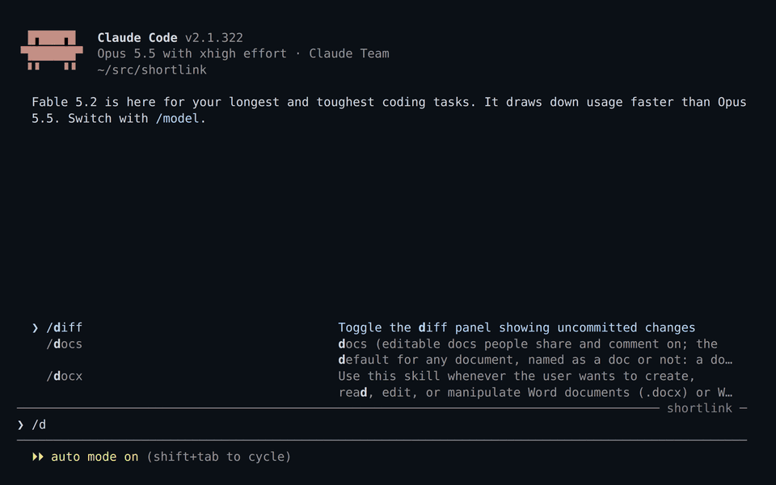

# GitHub Code Review

A Claude Code plugin that shows your code changes in a GitHub-style diff viewer in the browser.



```
/diff-review:review                          uncommitted changes
/diff-review:review main...feature           a branch, compared like a pull request
/diff-review:review topics: parser, docs     grouped into topics that Claude explains
```

Click a line number to comment. A comment that mentions `@claude` is answered in the page right away. The others wait until you press Submit review, and then Claude makes the changes and replies on each thread.

## Setup

```sh
claude plugin marketplace add RulerChen/github-code-review
claude plugin install diff-review@github-code-review
```

Requires Node.js 20 or newer and git. Update with `claude plugin update diff-review@github-code-review` and reload the plugin, remove with `claude plugin remove diff-review@github-code-review`.
