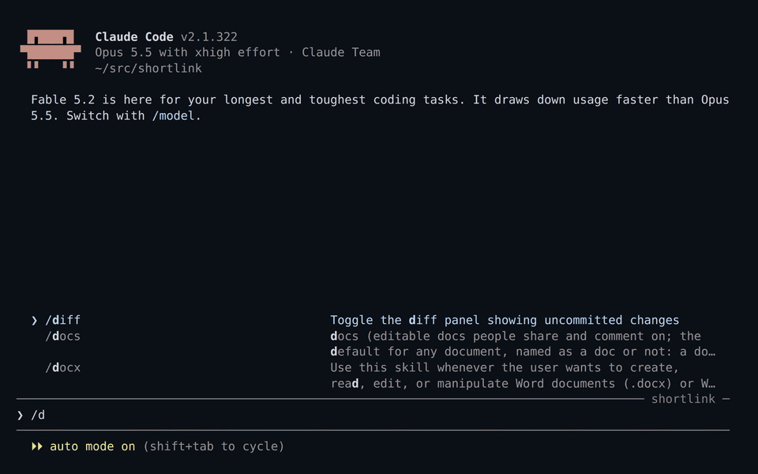

# GitHub Code Review

A Claude Code plugin that shows your code changes in a GitHub-style diff viewer in the browser.



```
/diff-review:review             uncommitted changes in the current repository
/diff-review:review ~/work      every repository in a folder, on one page
```

In the page you pick other branches, tags or commits to compare, and have Claude group the changes into topics that it explains. A topic can also list the flow its changes sit on, step by step through unchanged code and across repositories, and each step opens that line beside the diff.

## Setup

```sh
claude plugin marketplace add RulerChen/github-code-review
claude plugin install diff-review@github-code-review
```

```sh
claude plugin update diff-review@github-code-review
# reload the plugin after updating
```

```sh
claude plugin uninstall diff-review@github-code-review
```