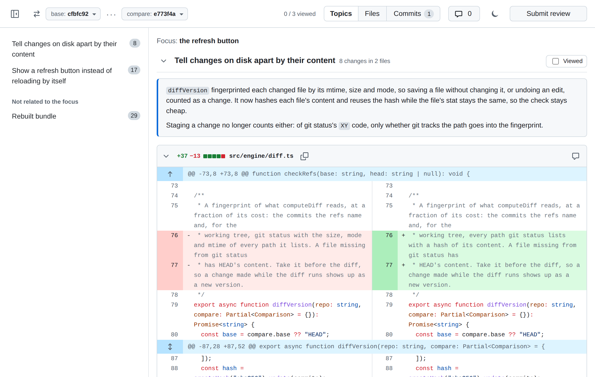

# GitHub Code Review

A Claude Code plugin that shows your uncommitted changes in a GitHub-style diff viewer in the browser.

## Screenshots



## Setup

```sh
claude plugin marketplace add RulerChen/github-code-review
claude plugin install diff-review@github-code-review
```

Requires Node.js 20 or newer and git.

```sh
claude plugin update diff-review@github-code-review
# then reload the plugin
```

```sh
claude plugin remove diff-review@github-code-review
```

## Remote development over SSH

The viewer listens on 127.0.0.1 port 7800, or on the next free port up to 7809 when other Claude Code sessions on the machine have a viewer open. When Claude Code runs on a remote machine, forward these ports in `~/.ssh/config` on your own machine, and the URLs it prints open in your local browser:

```
Host devbox
  LocalForward 7800 127.0.0.1:7800
  LocalForward 7801 127.0.0.1:7801
  LocalForward 7802 127.0.0.1:7802
  LocalForward 7803 127.0.0.1:7803
  LocalForward 7804 127.0.0.1:7804
  LocalForward 7805 127.0.0.1:7805
  LocalForward 7806 127.0.0.1:7806
  LocalForward 7807 127.0.0.1:7807
  LocalForward 7808 127.0.0.1:7808
  LocalForward 7809 127.0.0.1:7809
  ControlMaster auto
  ControlPath ~/.ssh/cm-%C
  ControlPersist 10m
```

The `Control` lines make further connections to the host share the first one and its forwards. Without them, each further connection prints a warning for every port the first one already forwards. A session that finds all ten ports taken uses a random port, and its URL opens only on the remote machine.
